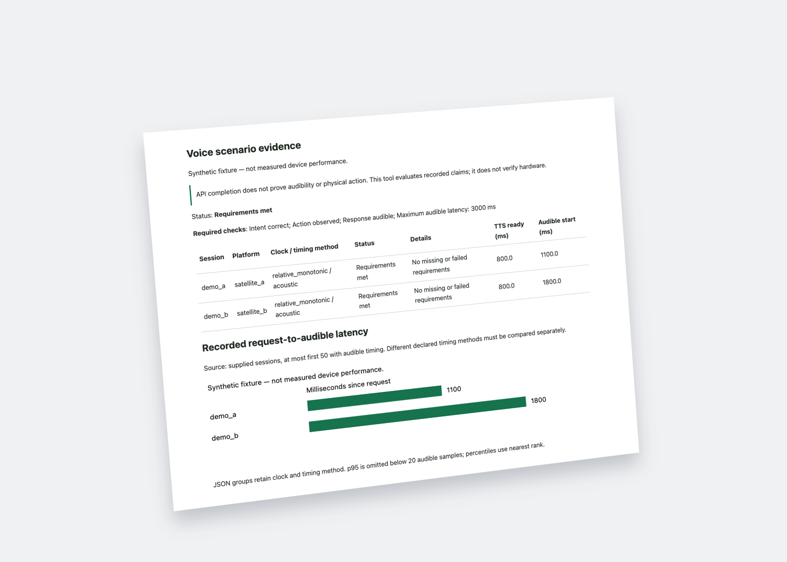

# Assist Scenario Lab

[English](README.md) · [Русский](README.ru.md) · [Deutsch](README.de.md) · [Español](README.es.md)

Lokale Auswertung aufgezeichneter Home-Assistant-Sprachabläufe. Ein abgeschlossener API-Aufruf, die richtige Aktion und eine hörbare Antwort werden getrennt bewertet. Das Werkzeug steuert keine Geräte und verbindet sich nicht mit Home Assistant.

**Betaversion: 0.1.1b1. Alle mitgelieferten Messwerte sind synthetisch.** Es liegt kein physischer Lautsprechervergleich vor. Eingetragene Beobachtungen werden nicht unabhängig bestätigt; `evidence_verified` bleibt false.


[](assets/report-preview.png)

Der echte HTML-Bericht aus den synthetischen Beispielen des Projekts, keine gemessene Geräteleistung. Ein Klick öffnet das unveränderte Original.

## Installation und Beispiel

Python 3.11 oder neuer, im ausgecheckten Projekt:

```sh
python3 -m venv .venv
. .venv/bin/activate
python3 -m pip install .
assist-lab evaluate examples/synthetic-pass.json --lang de
assist-lab evaluate examples/synthetic-pass.json --format html --lang de > /tmp/assist-report.html
assist-lab evaluate examples/synthetic-incomplete.json --lang de
```

Der letzte Aufruf liefert absichtlich **3**: Der Protokollablauf ist beendet, die Hörbarkeit unbekannt. **0** bedeutet erfüllte Anforderungen an die aufgezeichneten Daten, **1** einen Fehlschlag und **2** ungültige Eingaben.

## Funktionen und Grenzen

Strenge begrenzte JSON-Eingaben, Herkunft der Beobachtung, Latenzgrenzen sowie Text-, JSON-, HTML- und JUnit-Berichte. Ein Offline-Adapter übernimmt die Ereignisse eines HA-Laufs und verwirft sämtliche Nutzdaten, einschließlich Transkripten und Audio-Tokens. Zusammenfassungen trennen Plattform, Szenario, Zeitbasis und Beobachtungsmethode. p95 erscheint erst ab 20 Werten; das ist keine statistische Vertrauensgarantie.

Die CLI, Hilfe und Berichte unterstützen Deutsch, Englisch, Russisch und Spanisch. Maschinencodes bleiben sprachunabhängig. Die vollständigen technischen Anleitungen sind derzeit auf [Englisch](docs/en/guide.md) und [Russisch](docs/ru/guide.md) verfügbar; diese deutsche README ist ein eigenständiger Einstieg, keine vollständige Übersetzung der Referenz.


[Wiki](wiki/Home.md) · [Mitwirken und Übersetzung](CONTRIBUTING.md) · [Sicherheit](SECURITY.md) · [Änderungen](CHANGELOG.md)

```sh
python3 -m pip install -e .
python3 -m unittest discover -s tests -v
python3 tools/render_docs.py
```

MIT-Lizenz. Unabhängiges Projekt, keine offizielle Home-Assistant-Komponente.
