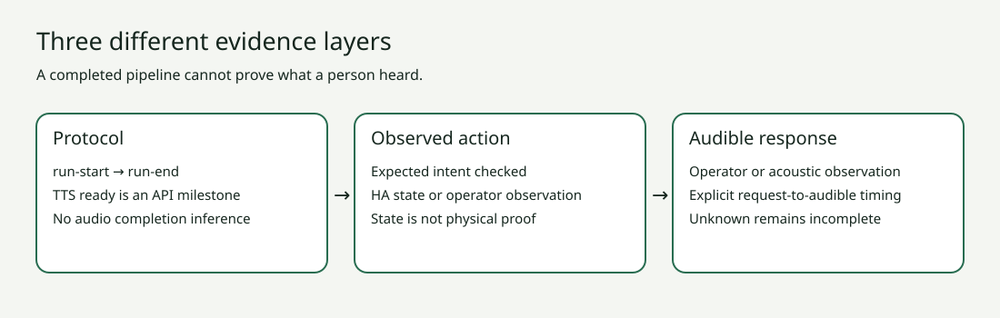

# Assist Scenario Lab

[English](README.md) · [Русский](README.ru.md) · [Deutsch](README.de.md) · [Español](README.es.md)

Проверка записанных голосовых сценариев Home Assistant: завершение API, правильность действия и слышимый ответ оцениваются отдельно. Утилита читает локальный JSON и создаёт текстовый, JSON, HTML или JUnit-отчёт. Подключения к HA и управления приборами в ней нет.

**Первый протестированный выпуск: 0.1.0. Все примеры синтетические.** Физическое сравнение колонок не проводилось. Наблюдения в файле — заявления автора; `evidence_verified` всегда false.



## Установка

Нужен Python 3.11 или новее. В каталоге проекта:

```sh
python3 -m venv .venv
. .venv/bin/activate
python3 -m pip install .
assist-lab evaluate examples/synthetic-pass.json --lang ru
assist-lab evaluate examples/synthetic-pass.json --format html --lang ru > /tmp/assist-report.html
assist-lab evaluate examples/synthetic-incomplete.json --lang ru
```

Последняя команда ожидаемо возвращает **3**: API завершился, но звук не подтверждён. **0** — требования к записанным данным выполнены; **1** — провал; **2** — неверный вход. Неизвестный физический результат не превращается в успех.

## Возможности

- Строгая ограниченная схема, происхождение наблюдений, пороги задержки и приоритет ошибки.
- Импорт массива событий одного запуска HA. Содержимое `data`, включая текст и токены аудио, отбрасывается.
- Группировка по платформе, сценарию, часам и методу наблюдения; p95 показывается только от 20 измерений. Это порог отображения, а не гарантия статистической достоверности.
- Интерфейс и справка на английском, русском, немецком и испанском. JSON-коды одинаковы для всех языков.
- Примеры успеха, провала и неполных данных, тесты и воспроизводимые SVG.


Это вымышленные платформы, не рейтинг реальных устройств.

Читайте [полное руководство](docs/ru/guide.md), [English guide](docs/en/guide.md), [wiki](wiki/Home.md), [правила переводов](CONTRIBUTING.md) и [безопасность](SECURITY.md). MIT. Независимый проект, не официальный компонент Home Assistant.

```sh
python3 -m pip install -e .
python3 -m unittest discover -s tests -v
python3 tools/render_docs.py
```
