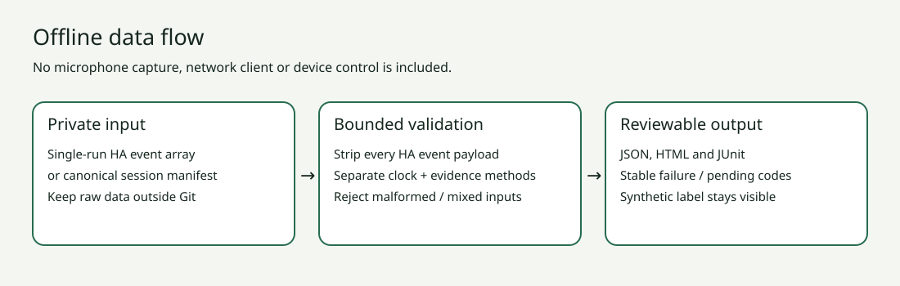

# Проверка записанных голосовых сценариев

## Установка и границы

В виртуальном окружении установите проект командой `python3 -m pip install .`. Нужен Python 3.11+. Дополнительных зависимостей времени исполнения нет. Справка: `assist-lab --help --lang ru`. Также доступны en/de/es; модуль запускается как `python3 -m assist_scenario_lab`.

Для загрузки файлов нужны флаги ОС `O_NOFOLLOW` и `O_NONBLOCK`, доступные в Linux и macOS. Если хотя бы одного нет, CLI завершает работу с кодом 2 и `unsupported_platform` до открытия файла. Python API для оценки и импорта данных в памяти этих флагов не требует.

Это локальный анализатор, не прошивка колонки, детектор звука, сборщик записей или HA-интеграция. Проверку оборудования выполняют отдельно. Утилита проверяет согласованность введённых наблюдений, но не удостоверяет их истинность.

## Формат входа

Возьмите `examples/synthetic-pass.json`. В корне обязательны `schema: assist-scenario-lab/v1`, булево `synthetic`, объект `requirements` и массив `sessions` из 1–500 запусков. Неизвестные поля запрещены. Каждый запуск содержит уникальный `id`, `platform`, `scenario`, `clock`, `events`, `checks`. Идентификаторы: 1–64 латинских букв, цифр, дефисов или подчёркиваний; первый символ — буква или цифра. Используйте псевдонимы без адресов и имён комнат.

Часы: `relative_monotonic` или `utc_derived`. Событие содержит `stage`, `at_ms`, `origin`. Время конечное, неотрицательное, максимум 12 часов, по возрастанию с допустимым равенством. Первым идёт `request` в нулевой момент; этапы не повторяются. Допустимы `request`, `wake_detected`, `stt_end`, `intent_end`, `tts_ready`, `protocol_end`, `playback_started`, `playback_finished`, `audible_start`, `error`. Для потокового ответа не задаётся дополнительный фиксированный порядок TTS/воспроизведения.

Источники: `pipeline`, `satellite`, `operator`, `acoustic`. Только два последних могут подтвердить момент `audible_start`. Все три проверки обязательны в данных: `intent_correct`, `action_observed`, `audible`. У каждой `result` pass/fail/unknown и `method`. Для unknown нужен none. Иначе метод: operator/intent_assertion для намерения, operator/ha_state для действия, operator/acoustic для слышимости. Событие audible_start требует pass у проверки audible.

В `requirements` включаются необходимые проверки и, при необходимости, `max_audible_ms`. Пропущенная или false-проверка не требуется: API-only политика может пройти без подтверждения физического результата, и это нужно явно подписывать. Примеры требуют все проверки. Событие error всегда даёт fail; отсутствие protocol_end — incomplete. Провал важнее отсутствующих данных. Превышение порога задержки — fail, отсутствие обязательной задержки — incomplete.

## Импорт HA

Принимается **массив событий одного запуска**, не полный журнал WebSocket и не ZIP диагностики. Локально извлеките тела событий с ключами `type`, `timestamp`, `data`. data — объект или null. Время — ISO 8601 с часовым поясом. Первый элемент — run-start, порядок хронологический, смешивать запуски нельзя.

```sh
assist-lab import-ha examples/ha-events.synthetic.json --session demo --platform demo --synthetic > /tmp/imported.json
assist-lab evaluate /tmp/imported.json --format json --lang ru
```

Вторая команда вернёт 3, это ожидается. run-end превращается в protocol_end, tts-end — в tts_ready. **Ни одно событие API не подтверждает слышимость.** Всё содержимое data отбрасывается: распознанный текст, ошибки, URL/токены аудио и метаданные. События начала, прогресса и VAD распознаются, но не сохраняются. Время utc_derived получено вычитанием настенных часов и может зависеть от их коррекции. Проверки действия, намерения и слышимости остаются unknown.

## Отчёты и интерпретация

Форматы: `--format text|json|html|junit`. Для записи применяйте перенаправление оболочки в отдельный файл. Коды: 0 — требования к записанным данным выполнены; 1 — провал; 2 — некорректный ввод; 3 — неполные данные. В JUnit incomplete обозначается skipped; CI всё равно должен учитывать код 3.

Группы разделяются по platform/scenario/clock/методу наблюдения звука. Не смешивайте разные часы и измерения человеком/акустикой. p50/p95 вычисляются методом ближайшего ранга; p95 отсутствует при числе наблюдений меньше 20. Это порог отображения, не гарантия статистической достоверности. Провалившиеся сценарии с зарегистрированным звуком остаются в выборке задержек, число провалов сохраняется. Не отбирайте только удачные попытки.

HTML показывает все запуски и график первых 50 наблюдений звука в общем масштабе. Это обзор, не рейтинг устройств. `evidence_verified` всегда false. `synthetic: false` означает только отсутствие отметки «синтетика», не независимую проверку оборудования. Идентификаторы пользователя могут раскрывать данные; проверяйте их перед публикацией.

## Как собирать данные

До запуска задайте ожидаемое намерение и цель. Фиксируйте один и тот же старт: запрос pipeline не обязательно совпадает с началом произнесения фразы. В отдельном приватном журнале храните версии ПО, язык, условия сети, расположение микрофона/динамика, метод и число попыток. Точную задержку звука измеряйте акустически; первый сетевой пакет её не заменяет. Учитывайте таймауты, провалы и пропуски. Синхронизацию акустики и согласие на запись этот пакет не реализует.

## Диагностика

- object_fields: сравните ключи с примером; полный экспорт диагностики не подходит.
- ha_timestamp/time_order: оставьте один запуск, добавьте часовой пояс, проверьте коррекцию часов. Не переставляйте события ради красивого результата.
- stage: неизвестный или повторный этап, возможно склеены два запуска.
- audible_origin/conflicting_audible: состояние воспроизведения не равно слышимому звуку.
- Код 3 после успеха API: нужны остальные обязательные наблюдения.
- `unsupported_platform`: ОС не предоставляет `O_NOFOLLOW` или `O_NONBLOCK`; используйте среду с обоими флагами (Linux или macOS). Файл не открывается, проверки ссылок и FIFO не ослабляются.
- file_size_type: обычный UTF-8 JSON до 2 МиБ; каталоги, FIFO и ссылки на конечный файл не принимаются. Ссылки в родительских каталогах не являются границей песочницы.
- number: запрещены отрицательные, бесконечные, булевы и превышающие 12 часов значения.

Ошибки содержат перевод и стабильный код без содержимого файла и локальных путей. Реальные экспорты держите вне репозитория.

## Архитектура и переводы



core.py — валидация/импорт/оценка, cli.py — форматы, locales/*.json — четыре словаря. Тесты проверяют совпадение ключей. Машинные коды не переводятся. Полные руководства есть на EN/RU, README и интерфейс — ещё на DE/ES. Это явно ограниченное покрытие переводов, а не обещание полной переведённой справки для всех языков.

Источники: [официальный протокол Assist](https://developers.home-assistant.io/docs/voice/pipelines/), [модели событий HA 2026.10.0](https://github.com/home-assistant/core/blob/2026.10.0/homeassistant/components/assist_pipeline/models.py), [жизненный цикл спутника](https://developers.home-assistant.io/docs/core/entity/assist-satellite/). Разделение протокола и акустического подтверждения — решение данного проекта.
